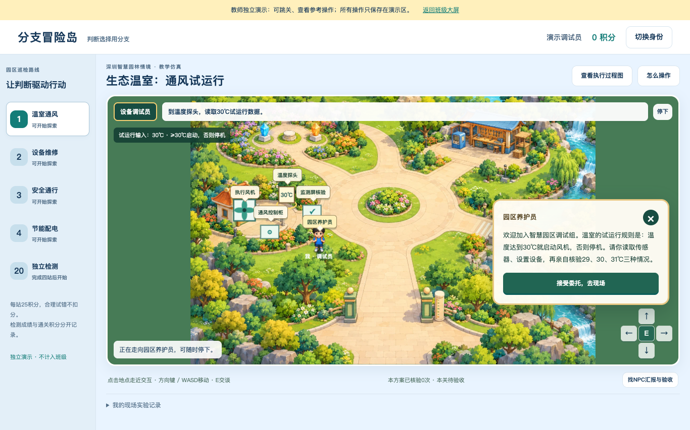

# 分支冒险岛 · 五年级第6课《判断选择用分支》

依据《身边的算法》本课目标与教学建议制作的2D角色扮演课堂应用。学生化身智慧公园设备调试员，控制本人角色行走，与NPC对话、读取现场输入、配置条件和两个出口，先预测，再执行设备或走选中路径到验证位置看结果。错误—反馈—修订—重验在剧情中发生，自动记录供教师观察。NPC与模型采用预制剧情和确定性规则，不调用学生实时AI服务。



## 本课主线

| 任务 | 学生思考 | 自动留下的证据 |
| --- | --- | --- |
| 温室通风 | 给定试运行规则≥30°C启动风机，否则关闭；恰好30怎么执行？ | 读取29/30/31→NPC预测→执行风机→现场核验，方案、原预测和解释 |
| 设备维修 | 条件由＜30换成≥30后，旧出口为什么出错？ | 检查原设备→预测→看到30°C错误关机→修订→三温度复验 |
| 安全通行 | 现场有/无可用过街设施时各走哪条安全路线？ | 观察→预测→实际走选中路线→到达核验，涵盖两种设施输入 |
| 节能配电 | 按本任务低电量优先规则，如何选两块电池中电量较小的一块？ | 读取两块电量→预测→走到充电口→验证，3/8与9/2两组及等价条件 |
| 20题独立检测 | 概念、推演、边界、调试、新生活规则迁移 | 首次/最近/历史成绩，提交后错题答案与解析 |

温度和电量为教学仿真数据。30°C是本任务试运行设定，不称为适用于所有植物或温室的科学结论；低电量优先也是本任务给定规则。

四站各25积分；积分与检测成绩分开。服务保存检测答对题数（满分20），界面换算为百分制。两种等价规则均接受；修改后当前验证失效，历史积分保留。操作帮助、概念提示和合理试错不扣分。句块解释需结合实际运行证据，不能单独证明理解。

推荐45分钟：导入3、四站探究26、检测12、收尾4。40分钟课保留至少25分钟有效探究，检测后半或订正续做。时间是设计预估，需课堂校准。

完整可编辑教案见 [教学设计](docs/教学设计.md)，教材页码与取舍见 [教材依据](docs/教材依据.md)。本仓库不附教材全文或原图。

## 启动课堂

运行要求 **Node.js 22.13或更新版本**，零运行依赖，不需安装前端框架或联网加载图片。

macOS双击 `启动课堂.command`。脚本为本应用注册独立的用户服务，关闭终端后继续运行，当前用户下次登录也自动恢复。默认8766端口；若被其他程序占用，会保留原服务并提示。双击 `停止课堂.command` 可停止并停用自动启动，不删除名单和学习记录。

其他系统或临时运行：

```sh
node server.cjs
```

直接运行时需要保持窗口开启。可用 `PORT=8766 HOST=0.0.0.0 node server.cjs` 指定参数；Windows使用对应环境变量设置方式。

- 学生入口：`http://教师电脑局域网IP:8766/`
- 教师大屏：`http://教师电脑局域网IP:8766/teacher.html`
- 教师独立测试：从大屏右上角进入，可跳关、查看参考操作与答案、体验积分和检测。
- 教师本机可用 `http://localhost:8766/`；学生电脑不能使用教师机的localhost。

教师大屏免密码，页面与教师API均开放本机和私有局域网。学生页面不展示教师入口。隐藏网址不构成认证；在受控机房网络使用，不将8766端口映射到公网。班级选名用于课堂身份记录，不是安全账户认证。

## 名单与数据迁移

公开仓库仅有 `roster.example.json` 虚构名单，下载后即可试用。正式课堂把本地 `roster.json` 放在项目根目录；没有它时自动使用示例。格式：

```json
{"classes":[{"id":"501","students":[{"id":"501-001","name":"示例同学"}]}]}
```

支持501—504班，先选班再选姓名，可搜索和名单外补充。`id`必须稳定且全局唯一，同名学生用不同id；维护名单时保留原id，不按重排后的行号重新编号。名单更新不会自动删除数据库里的学习记录。教师明细会显示当前名单及手动补充身份。

本次教师电脑的正式名单来自五年级班级姓名名单.xlsx，共212人（501:53、502:53、503:52、504:54）；此文件只在本地，未提交Git。

运行数据保存在 `runtime/classroom.sqlite`。备份/换电脑时先停止课堂，再复制整个 `runtime/` 与正式 `roster.json` 到新电脑的同名目录，再启动。不要只复制正在写入的主SQLite文件。环境变量 `DATA_DIR` 与 `ROSTER_PATH` 可指定其他数据目录或名单。当前应用固定第1轮，未提供清空或教师开启新轮次的管理操作；重玩只重新验证，不重复发积分。

已同步记录可在另一设备选同一身份恢复。浏览器暂时断网时保留按身份隔离的待同步队列，恢复后自动重传与去重；出现同步提示时不要清理浏览器存储。未同步记录只在原设备，不能保证换设备立即恢复。教师独立测试只保存本机演示状态，完全不写学生进度、积分和班级统计。

## 教师使用大屏

按班看进入/未进入、各站历史完成与当前验证、首次/最近检测及学生证据。班级统计分母是当前全班（含补充身份）；未检测者显示“尚无证据”，不记0分。错题卡点只按当前温室版的首次检测统计；历史版本成绩保留并标注，不作同卷增益比较。姓名查询只筛选明细，不改变班级图表分母。

可展开学生查看每次场景动作摘要、原预测与实际输出是否相符、输入/配置/实际条件与路径/结果和修改理由，按卡点安排当堂支持。错误预测和错误配置分开看，错误实验照样保留。场景摘要由页面在关键交互完成后提交，服务端核对与模型一致，不逐帧证明行走；请结合课堂观察与口头解释核对。高积分、理由句块或重做高分不能单独证明独立迁移；建议在收尾给新输入或新阈值，观察学生独立预测并解释。

旧版门票实验、积分、检测和进度保留，运行明细标“规则实验（旧版）”；新温室模型有独立配置标识，旧身高测试不会充当新温室的温度证据。内部关卡id仍沿用sale/repair/cross/minimum，以兼容数据，学生界面使用四站新名称。

## 验证与文件边界

```sh
npm test
```

测试使用临时目录与虚构名单，覆盖新旧模型边界与隔离、等价方案、场景角色/输入/动作/结果校验、有限场景草稿、错误实验保留、锁关、先诊断后修订、积分与事件去重、旧草稿保护、题库版本、考试历史、重启恢复、跨源写入拒绝、静态数据隔离和同步引用。具体浏览器验收结果见 [验收记录](docs/验收记录.md)。

正式名单、运行数据库、日志和临时测试目录均被 `.gitignore` 排除。发布前仍需检查实际Git文件列表，不将其作为唯一保护。地图和角色等位图由可用imagegen工具生成，以WebP浏览器副本加载，保留PNG原图；实时人物、交互对象、设备状态和界面由程序叠加，不依赖字体CDN或临时图床。素材来源、生成提示与使用约定见[美术素材](docs/美术素材.md)。

新场景实际浏览器走查须以最新验收记录为准，文档修订本身不代表已验收。尚未完成整班并发、真实学生首次试用与课堂计时，不能把程序测试当作兴趣提升或学习效果证据。团体8折仅列为教案延伸，不是本轮程序关卡；循环、Python、多分支留后续课学习。

深圳真实智慧园林来源与课堂仿真边界见[教材依据](docs/教材依据.md#深圳真实场所的来源与教学转化)。当前参考真实智慧养护工作，地图和任务参数为课堂设计。
